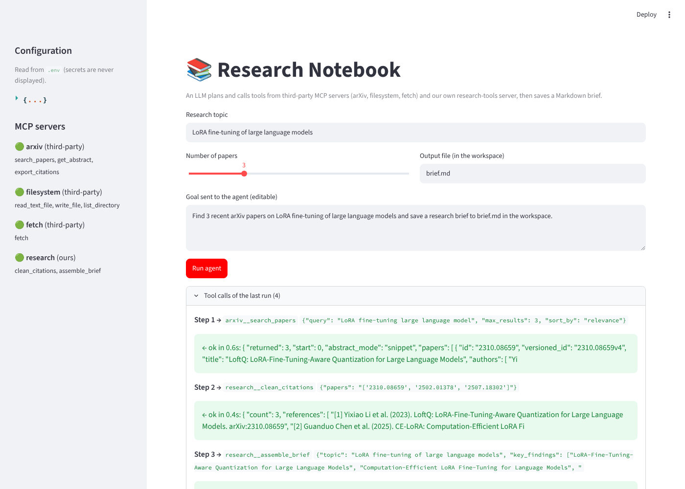

# Mini-Project (Part 1): Research Notebook, an LLM agent over third-party MCP servers

**Research Notebook** turns a goal such as *"Find 3 recent arXiv papers on LoRA fine-tuning and save a brief to lora_brief.md"*
into a Markdown research brief.

An LLM (GroqCloud or a local Ollama model) **plans the work itself**. It decides which MCP tool to call next and with
which arguments. The tools come from three community MCP servers plus one server of our own, all started locally
over STDIO:

| Server | Origin | Launch command (from `.env`) | Tools exposed to the LLM |
|---|---|---|---|
| `arxiv` | third-party: [blazickjp/arxiv-mcp-server](https://github.com/blazickjp/arxiv-mcp-server) | `uvx arxiv-mcp-server --storage-path ./workspace/papers` | `search_papers`, `get_abstract`, `export_citations` |
| `filesystem` | third-party: [modelcontextprotocol/servers (filesystem)](https://github.com/modelcontextprotocol/servers/tree/main/src/filesystem) | `npx -y @modelcontextprotocol/server-filesystem ./workspace` | `write_file`, `read_text_file`, `list_directory` |
| `fetch` | third-party: [modelcontextprotocol/servers (fetch)](https://github.com/modelcontextprotocol/servers/tree/main/src/fetch) | `uvx mcp-server-fetch` | `fetch` (also powers the search fallback) |
| `research` | **ours**: `research_tools_server.py` (FastMCP) | `python research_tools_server.py` | `clean_citations`, `assemble_brief` |



## Architecture

```
            Streamlit UI (app.py)  /  CLI (cli.py)
                          │ goal
                          ▼
   agent/orchestrator.py ── plan → act → observe loop ──►  LLM (GroqCloud | Ollama, OpenAI-compatible API)
                          │  tool calls chosen by the LLM            ▲ tool results / errors
                          ▼                                          │
   agent/mcp_hub.py  ── one ClientSession per server (STDIO), namespaced tools "server__tool",
                        timeouts, retries, fallback, allow-list
        │                 │                    │                     │
   arxiv-mcp-server   server-filesystem    mcp-server-fetch     research_tools_server.py (ours)
   (search papers)    (write the brief,     (read web pages;     (clean_citations,
                       sandboxed folder)     search fallback)     assemble_brief)

   agent/observability.py ── every call → logs/run_<timestamp>.jsonl (args/results summarised, secrets redacted)
   agent/config.py        ── everything comes from .env (backend, model, server commands, limits)
```

A typical run, in an order **chosen by the LLM** (real run in [`sample_output/console_nominal.txt`](sample_output/console_nominal.txt)):

1. `arxiv__search_papers`: the third-party arXiv server returns 3 real papers.
2. `research__clean_citations`: our server deduplicates and formats the references. If the LLM passes only arXiv ids, our server looks up the metadata.
3. `research__assemble_brief`: our server builds the Markdown brief (summary, key findings, references).
4. `filesystem__write_file`: the third-party filesystem server saves it inside `workspace/`.

The result is [`sample_output/lora_brief.md`](sample_output/lora_brief.md).

## How each requirement is met

| Requirement | Where / how |
|---|---|
| ≥ 2 third-party MCP servers, run locally, connected from an MCP client | `arxiv`, `filesystem` and `fetch` are started over STDIO by `agent/mcp_hub.py`, which uses the official `mcp` Python client (`ClientSession`, `list_tools`, `call_tool`). |
| The LLM plans and orchestrates the calls (nothing hard-coded) | `agent/orchestrator.py` sends every tool's JSON schema to the LLM (function calling). The LLM picks the next tool and its arguments at each step. The system prompt only *suggests* a plan. |
| GroqCloud or Ollama | `LLM_BACKEND=groq` (with `GROQ_API_KEY`, default `llama-3.3-70b-versatile`) or `LLM_BACKEND=ollama` (default `qwen2.5:3b`). Both go through the OpenAI-compatible API. |
| Composition: 2+ third-party servers **and** our own server in one flow | arxiv (third-party) → research (ours) → research (ours) → filesystem (third-party), in a single run. |
| Error handling: retries | Every MCP call has a timeout (`TOOL_TIMEOUT_S`) and up to `TOOL_RETRIES` retries with backoff, each one logged. LLM calls are retried 3 times. |
| Error handling: fallbacks | (1) A server that fails to start is skipped and the app keeps running with the others. (2) If arXiv search is down, `arxiv__search_papers` is served by a **provider fallback**: the `fetch` server queries the Semantic Scholar API. (3) Tool errors go back to the LLM as `ERROR: … Adapt`, so it can fix the arguments or pick another tool. (4) An identical call that already failed is not replayed. (5) After 3 failures in a row, the LLM is nudged to change approach. (6) Before accepting the final answer, the agent checks that the requested file was actually written. (7) At the step limit, the agent asks for a final answer without tools. |
| Observability: log each tool call, no secrets | `agent/observability.py` writes one JSONL line per event (`server_connected`, `tool_call`, `tool_result` with duration and ok/error, `tool_retry`, `fallback_*`, `final`). Arguments and results are summarised (300 characters max), and keys/tokens are redacted (`gsk_…`, `sk-…`, `api_key=…`). The UI shows only `public_summary()` (the API key appears as `set` / `not set`). |
| Env-based configuration | `.env` (template: `.env.example`) holds the backend, model, server launch commands, workspace, per-server tool allow-lists (`ARXIV_TOOLS=…`), steps, timeouts and retries. |
| Reproducible, short startup | See **Quick start** below. |
| Streamlit UI | `app.py`: sidebar with the configuration and server status, the goal form, a live timeline of tool calls, the final answer, the rendered brief with a download button, the resilience events and the full run log. |

## Quick start

Prerequisites: Python ≥ 3.10, [uv](https://docs.astral.sh/uv/) (`uvx`) and Node.js ≥ 18 (`npx`). The third-party servers are downloaded automatically the first time they start.

```bash
cd Week18/Day5/MiniProject
pip install -r requirements.txt
cp .env.example .env          # choose the LLM backend (see below)
streamlit run app.py          # or: python cli.py "Find 3 recent arXiv papers on X and save a brief to x.md"
```

LLM backend, choose one:

- **GroqCloud** (best results): in `.env`, set `LLM_BACKEND=groq` and `GROQ_API_KEY=gsk_…` (free key at <https://console.groq.com/keys>).
- **Ollama** (local, no key): install it from <https://ollama.com>, run `ollama pull qwen2.5:3b` (any model that supports tool calling works), and keep `LLM_BACKEND=ollama`.

Checks that need no LLM: `python tests/smoke_test.py`. It covers secret redaction, our MCP server over STDIO, the unknown-tool error, and the timeout path (attempts logged, then a clean error).

## Files

```
MiniProject/
├── app.py                    # Streamlit UI
├── cli.py                    # terminal runner (prints every tool call)
├── research_tools_server.py  # our MCP server (FastMCP): clean_citations, assemble_brief
├── agent/
│   ├── config.py             # .env → Settings (no secrets in public_summary)
│   ├── mcp_hub.py            # multi-server MCP client: namespacing, allow-list, timeouts, retries, fallback
│   ├── orchestrator.py       # LLM plan → act → observe loop + guards
│   └── observability.py      # JSONL run logs, redaction
├── tests/smoke_test.py
├── sample_output/            # real runs made with Ollama qwen2.5:3b
├── .env.example  requirements.txt  screenshot_streamlit.png
└── workspace/  logs/         # created at runtime (git-ignored)
```

## Real runs (Ollama `qwen2.5:3b`, CPU)

- **Nominal** ([`console_nominal.txt`](sample_output/console_nominal.txt), [`run_nominal.jsonl`](sample_output/run_nominal.jsonl)): 4 tool calls across 3 servers (arxiv → research ×2 → filesystem) produce a brief with 3 real arXiv references.
- **arXiv server down** (`ARXIV_SERVER_CMD` points to a non-existent package; [`console_arxiv_down.txt`](sample_output/console_arxiv_down.txt), [`run_arxiv_down.jsonl`](sample_output/run_arxiv_down.jsonl)):
  - The failed server is logged and skipped, and the fallback is enabled.
  - The fallback search is tried 3 times with backoff; each attempt is logged. Semantic Scholar answered HTTP 429, because this run's sandbox shares its IP with others.
  - The LLM keeps going with the remaining servers and still writes a file.
- **Known limitation, shown honestly by the second run.** With no source available, the 3B model invents generic findings and once writes a placeholder instead of the brief. The plumbing works (retries, fallback, logs, completion check), but a model this small plans poorly. With GroqCloud `llama-3.3-70b-versatile` the plans are much more reliable. A production version would also refuse to write a brief without references.
