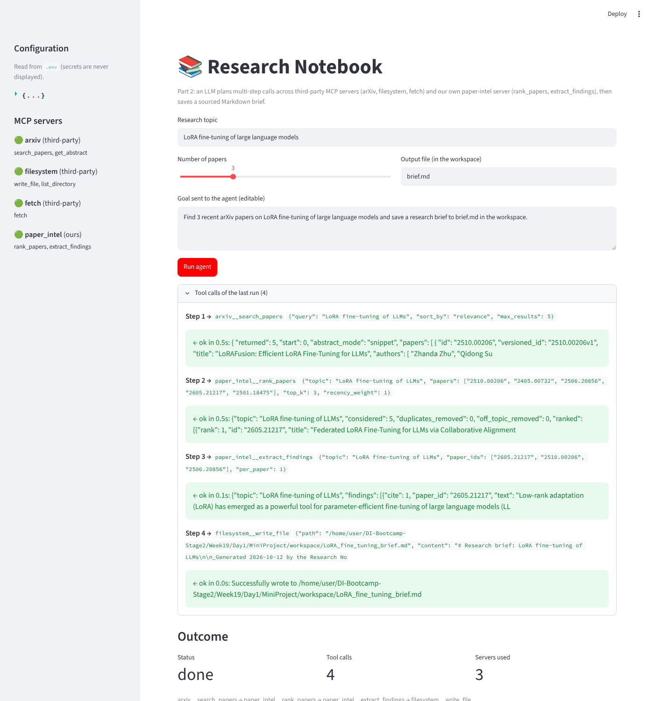

# Mini-Project (Part 2): our own MCP server, composed with the Part 1 servers

Part 1 ([`Week18/Day5/MiniProject`](../../../Week18/Day5/MiniProject)) built **Research Notebook**, an LLM agent that plans
calls across third-party MCP servers. Part 1 showed where that falls short. The papers returned by search were
not always on topic, and with a small LLM the "key findings" were paper titles or were made up.

Part 2 adds **`paper-intel`**, an MCP server of our own. It brings the two capabilities that were missing:

| Tool | Kind | What it adds |
|---|---|---|
| `rank_papers(topic, papers, top_k=3, recency_weight=0.3)` | **decision step** + **enrichment** (arXiv API) | Accepts the search JSON *or just a list of arXiv ids*. Missing titles and abstracts are fetched from the arXiv API, with batching, caching and retries. Duplicates are removed. Each paper is scored on **BM25 relevance** to the topic (title counts double, acronyms are expanded: LLMs → large language models) and on **recency** (the weight halves every 2 years). **Off-topic papers are rejected**: a paper must match at least 50% of the topic terms. The tool returns `top_k` papers, each with its score breakdown and a reason. When too few papers pass, `next_step` tells the planner to search again. |
| `extract_findings(topic, paper_ids, per_paper=1)` | **transformation** | For each paper, picks the abstract sentence that states a result ("we show", "outperforms", "reduces … by 3×", …) and is closest to the topic. The sentence is **quoted verbatim** and gets a `[n]` citation. The tool returns the numbered references and a ready-to-save **`brief_markdown`**, so the LLM cannot invent findings. |

Both tools have explicit input schemas (type hints and docstrings) and **typed output schemas** (pydantic
models: `RankResult`, `FindingsResult`), which MCP clients receive as `outputSchema`.



## One orchestration: our server and 2+ external servers

```
 goal ──► LLM planner (GroqCloud | Ollama) ──► chooses the next tool from what the previous one returned
              │
              ├─ arxiv__search_papers            third-party  arxiv-mcp-server (uvx)
              ├─ paper_intel__rank_papers        OURS         paper_intel_server.py (FastMCP, STDIO)
              │     └─ "only 1 on-topic paper: search again…"  → the LLM re-plans
              ├─ paper_intel__extract_findings   OURS
              ├─ filesystem__write_file          third-party  @modelcontextprotocol/server-filesystem (npx)
              └─ fetch__fetch                    third-party  mcp-server-fetch (uvx): optional, also the search fallback
```

The client (`agent/`) is the Part 1 client, extended:

- **Discovery:** `list_tools()` on every server. Tools are namespaced `server__tool`, filtered by a per-server
  allow-list from `.env`, and sent to the LLM as function specs. Servers that fail to start are reported and skipped.
- **Planning prompt** (`agent/orchestrator.py`): describes each server's role and a *suggested* plan. Each of our
  results carries a `next_step` hint. The LLM decides every call from the intermediate results.
- **Output normalisation:**
  - typed results (`structuredContent`) are turned into compact JSON, and `{"result": x}` / `{"content": x}` into `x`;
  - Markdown fences added by the LLM around file content are stripped before `write_file`;
  - the run ends with a structured **outcome**: status, saved file, servers used, call sequence, failed calls.
- **Robustness:**
  - timeouts and retries with backoff on every MCP call; LLM calls are also retried;
  - our server retries the arXiv API and degrades gracefully;
  - tool errors go back to the LLM so it can re-plan;
  - an identical call that has failed twice is blocked;
  - after 3 failures in a row the LLM is nudged to change approach;
  - a completion check confirms the requested file was written before the final answer is accepted;
  - a search fallback goes through fetch + Semantic Scholar;
  - `FAULT_INJECT` simulates outages to **test re-planning**.
- **Runtime options:** `LLM_BACKEND=groq` (`GROQ_API_KEY`, default `llama-3.3-70b-versatile`) or `LLM_BACKEND=ollama`
  (default `qwen2.5:3b`). Both go through the OpenAI-compatible API, configured only in `.env`.
- **Observability:** one JSONL line per event in `logs/` (summarised arguments and results, secrets redacted).

## Quick start

Prerequisites: Python ≥ 3.10, [uv](https://docs.astral.sh/uv/) (`uvx`) and Node.js ≥ 18 (`npx`).

```bash
cd Week19/Day1/MiniProject
pip install -r requirements.txt
cp .env.example .env               # LLM_BACKEND=groq + GROQ_API_KEY, or LLM_BACKEND=ollama (ollama pull qwen2.5:3b)
streamlit run app.py               # UI
python cli.py "Find 3 recent arXiv papers on <topic> and save a research brief to brief.md in the workspace."
python tests/smoke_test.py         # no LLM needed
```

To test re-planning, set `FAULT_INJECT=paper_intel__rank_papers:1` (the first call fails with a simulated outage).

## Test scenarios (real runs, Ollama `qwen2.5:3b` on CPU, in `sample_output/`)

**1. Nominal: "Find 3 recent arXiv papers on LoRA fine-tuning of large language models and save a brief"**
([console](sample_output/console_nominal.txt) · [log](sample_output/run_nominal.jsonl) · [brief](sample_output/nominal_brief.md))

| Step | Tool chosen by the LLM | Server | Result |
|---|---|---|---|
| 1 | `arxiv__search_papers` (relevance, 5 results) | third-party | 5 papers |
| 2 | `paper_intel__rank_papers` (top_k 3; the LLM set `recency_weight` 1) | **ours** | 3 papers kept, with score breakdown |
| 3 | `paper_intel__extract_findings` (ranked ids) | **ours** | 3 quoted findings, 3 references, `brief_markdown` |
| 4 | `filesystem__write_file` | third-party | brief saved |

Outcome: `status: done`, 4 calls, 0 failures, 3 servers. Every finding is a real sentence from the paper's abstract
(e.g. *"LoRAFusion achieves up to 1.96× … end-to-end speedup compared to Megatron-LM"* [2]).

**2. Re-planning on failures: `FAULT_INJECT="arxiv__search_papers:1,paper_intel__rank_papers:1"`** (RAG for QA)
([console](sample_output/console_replan_fault_inject.txt) · [log](sample_output/run_replan_fault_inject.jsonl) · [brief](sample_output/replan_brief.md))

- The first search fails. The LLM **re-plans with a different query** (it drops the exact-phrase quotes), and the call succeeds.
- The first `rank_papers` call fails. The LLM retries it once; the loop guard allows one retry of a call that failed.
  The call succeeds, and the run continues: `extract_findings`, then `write_file`.
- Outcome: `status: done`, 6 calls, 2 failures (both injected), `fault_injected` events in the log.

**3. Checks that need no LLM** (`tests/smoke_test.py`):
- typed outputs over STDIO;
- duplicates removed and an **off-topic paper rejected** by `rank_papers`;
- an injected fault returns an error without retries, then the next call succeeds;
- bad input returns a tool error the LLM can act on;
- an unknown tool returns a readable error;
- a timeout is retried, each attempt is logged, then a clean error is returned.

**What the runs show honestly** (small 3B model on CPU):
- the LLM sometimes picks its own file name instead of the one requested;
- when an abstract has no explicit result sentence, `extract_findings` falls back to its most topic-relevant
  sentence, which can be a background statement (finding [1] in run 1, [2] in run 2);
- with GroqCloud `llama-3.3-70b-versatile` the plans are more precise. The client and our server are the same.

## Files

```
MiniProject/
├── paper_intel_server.py     # OUR MCP server: rank_papers, extract_findings (typed outputs)
├── agent/
│   ├── config.py             # .env → Settings (servers, allow-lists, LLM backend, FAULT_INJECT)
│   ├── mcp_hub.py            # discovery, namespacing, timeouts/retries, fallback, fault injection, output normalisation
│   ├── orchestrator.py       # LLM planning loop, argument normalisation, guards, structured outcome
│   └── observability.py      # JSONL logs + redaction
├── app.py  cli.py            # Streamlit UI / terminal runner
├── tests/smoke_test.py       # server, typed outputs, errors, fault injection, retries
├── sample_output/            # real run logs and briefs
└── .env.example  requirements.txt
```
